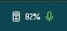
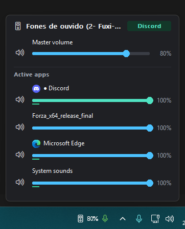

# Windows Taskbar Audio

[](https://github.com/vinny/windows-taskbar-audio/actions/workflows/ci.yml)
[](https://github.com/vinny/windows-taskbar-audio/actions/workflows/release.yml)

**See your master volume, active output device, and a fast per-app volume mixer right on the Windows 11 taskbar.** No more digging through three layers of Windows Quick Settings just to turn down a loud browser tab or switch from your headset to your speakers.



- **Always visible:** sits on the taskbar just left of the system tray, showing an icon for your active output (headset, headphones, speakers, HDMI monitor), the current volume percentage, and optionally a short device name.
- **Fast controls where you need them:**
  - **Mouse wheel (scroll)** over the widget adjusts master volume right away.
  - **Left-click** opens a lightweight per-app mixer with individual sliders, mute buttons, and live audio peak meters for every open app.
  - **Middle-click** mutes or unmutes master volume immediately.
  - **Right-click** lists all connected output devices so you can switch your default audio output in one click.
- **Call / communication indicator:** when you join a voice call (Discord, Teams, Zoom, Meet, Slack, or anything using your microphone), the widget shows a green mic icon so you can tell at a glance that communication audio is active.
- **Lightweight:** a single ~510 KB Rust executable (available for both **x64** and **ARM64**). It uses under 1 MB of RAM in Task Manager, needs no installer or runtime DLLs (not even the Visual C++ Redistributable), and updates instantly via Windows Core Audio callbacks.
- **Multi-language:** automatically follows your Windows display language (English, Portuguese, Spanish, French, and German) or lets you pick one from the right-click menu.
- **Built-in updater:** checks GitHub Releases over TLS 1.2/1.3, verifies the downloaded binary against `SHA256SUMS.txt` using Windows CNG, and can replace and restart itself in place.

> [!NOTE]
> This project was built with the help of Gemini 4 Argon.

---

## Install

### Option 1: Microsoft Store
Install directly from the [Microsoft Store](https://apps.microsoft.com/detail/9NRCF7XB49KG) (automatic updates and Microsoft-signed package).

### Option 2: Standalone executable (GitHub)
1. Download **`taskbar-audio.exe`** (or **`taskbar-audio-arm64.exe`** for Windows on ARM) from the [latest release](../../releases/latest).
2. Put it in a permanent folder. A good spot is:
   ```
   %LOCALAPPDATA%\Programs\taskbar-audio\
   ```
   It registers itself to start with Windows from wherever you run it, so don't launch it straight from your `Downloads` folder.
3. Double-click it. Your volume and active device appear on the taskbar, just left of the system tray.

> **Windows SmartScreen prompt?** Because the binary isn't signed with a paid certificate, Windows may show *"Windows protected your PC"* on first launch. Click **More info → Run anyway**, or [build it from source](#build-from-source) yourself.

---

## Using it

### Reading the taskbar widget

| What you see | Meaning |
|---|---|
| 🎧 `74% PRO X Wireless` | Master volume and active output device. Text color adapts to light and dark taskbar themes |
| 🔇 `Muted` (in red) | Master output is muted |
| 🎧 `74%` + 🎙️ (in green/teal) | **Communication mode active** — an app is in a voice call (Discord, Teams, Zoom…) or actively using the microphone |

Want a more compact look (`🎧 74%` without the device name)? Right-click the widget and uncheck **Show device name on taskbar**.

**Hover** over the widget to see the full output device name, which app is currently in a call, and the volume levels of your active applications.

### Quick app mixer (left-click)



Left-click the widget to pop open the mixer right above the taskbar:

- **Master volume** at the top.
- **Active apps** below: every program with an open audio session gets its own icon, slider, and mute button.
- **Mouse or keyboard:** drag a slider, click the speaker icon to mute a specific app, hover over any row and roll your mouse wheel, or use the keyboard (`Tab` / `↑` / `↓` to select a row, `←` / `→` to adjust volume, `Space` or `M` to mute, `Esc` to close).
- A thin green meter under each slider shows live audio output levels in real time.
- Respects multi-monitor setups and Windows High Contrast mode automatically.
- Click anywhere outside (or press `Esc`) to close it.

### Right-click menu

Right-click the widget for quick actions:

- **Mute / Unmute master volume**
- **Open app volume mixer**
- **Output device list:** every connected playback device is listed with a checkmark on the current default. Click any device to switch Windows' default audio output (updates Console, Multimedia, and Communications roles at once).
- **Input device (Microphone):** submenu listing your connected microphones so you can switch your default recording/voice input in one click.
- **Language:** Automatic (follows Windows) or manual selection (English, Português, Español, Français, Deutsch).
- **Show device name on taskbar:** toggle the short device label next to the percentage.
- **Start with Windows:** enabled by default, and stays in sync with Windows' *Task Manager → Startup apps* toggle.
- **Check for updates:** queries GitHub Releases and offers a one-click self-update.
- **Copy diagnostics** and **Exit**.

---

## How it works

Windows 11 removed the legacy `IDeskBand` API that old taskbar toolbars used. `taskbar-audio` creates a small per-pixel transparent child window (`WS_CHILD` + `WS_EX_LAYERED`) attached directly to `Shell_TrayWnd` and positions it just left of `TrayNotifyWnd`.

- **Core Audio (WASAPI):** reads and controls master volume, per-process audio sessions, and real-time peak meters straight through Windows' native COM interfaces (`IMMDeviceEnumerator`, `IAudioEndpointVolume`, `IAudioSessionManager2`, `ISimpleAudioVolume`, and `IAudioMeterInformation`), and subscribes to `IAudioEndpointVolumeCallback` and `IMMNotificationClient` so hardware media keys and device plug/unplug events reflect immediately.
- **Instant output & mic switching:** uses Windows' `IPolicyConfig` COM interface to switch the default playback or recording endpoint across all audio roles without opening Settings.
- **Explorer restarts:** listens for `TaskbarCreated` broadcasts so the widget is recreated automatically if `explorer.exe` restarts.
- **Zero-dependency updater:** uses native `WinHTTP` (TLS 1.2/1.3) and Windows CNG (`bcrypt.dll`) to check GitHub Releases, verify the binary's SHA-256 checksum against `SHA256SUMS.txt`, rename the running binary to `.old.exe`, and relaunch cleanly.

---

## Uninstall

1. Right-click the widget → uncheck **Start with Windows** → click **Exit**.
2. Delete `taskbar-audio.exe`.
3. Optionally, clean up its registry keys and log folder:
   ```cmd
   reg delete HKCU\Software\taskbar-audio /f
   reg delete HKCU\Software\Classes\AppUserModelId\TaskbarAudio /f
   rmdir /s /q "%LOCALAPPDATA%\taskbar-audio"
   ```

---

## Build from source

Requirements: [Rust](https://rustup.rs) (stable) and the Visual Studio C++ Build Tools (MSVC) with the Windows SDK installed.

```sh
git clone https://github.com/vinny/windows-taskbar-audio
cd windows-taskbar-audio
./build-clean.ps1                # builds release exe, copies it to root, and wipes target/ + Cargo caches
```

Or if building manually with Cargo:

```sh
cargo build --release            # -> target/release/taskbar-audio.exe
./build-clean.ps1 -CleanOnly     # deletes target/ and unpacked crate caches (~1.4 GB saved)
```

For a **Microsoft Store (MSIX)** compliant build (uses the official system tray `Shell_NotifyIconW`, disables self-update, and relies on MSIX `StartupTask`):

```sh
cargo build --release --no-default-features --features store
```

Useful debug and CLI flags:

```sh
cargo run                        # run the widget with console logs
cargo run -- --once              # print active output, devices, and app sessions, then exit
cargo run -- --demo              # run with simulated devices, apps, and call indicator
cargo run -- --check-update      # check GitHub Releases for a newer version
```

### Project layout

```
src/
├── main.rs       entry point, panic handler, and CLI flags
├── audio.rs      WASAPI / Core Audio endpoints, per-app sessions, output switching, and call detection
├── widget.rs     taskbar child window, placement logic, context menu, and background worker
├── render.rs     per-pixel alpha taskbar drawing (UpdateLayeredWindow + Segoe Fluent Icons)
├── mixer.rs      custom Windows 11 flyout mixer with live peak meters and mouse wheel support
├── i18n.rs       built-in translations (EN, PT, ES, FR, DE) and Windows UI language detection
├── updater.rs    GitHub Releases checker and in-place self-updater over WinHTTP
├── settings.rs   registry settings and Windows Startup apps integration
├── notify.rs     WinRT toast notifications
├── diag.rs       local diagnostics log for troubleshooting
└── win32_raii.rs RAII guards for COM, GDI, and WinHTTP handles
assets/
└── icon.svg      vector application icon (rasterized at compile time by build.rs)
packaging/msix/
└── AppxManifest.xml  MSIX package manifest for Microsoft Store builds
build.rs          renders icon.svg and embeds the icon, version info, and PerMonitorV2 manifest
```

---

## Contributing

Contributions are welcome! Whether you ran into a bug, have an idea for an improvement, or want to see `taskbar-audio` in your language:

- **Bugs & feature requests:** [open an issue](../../issues) and attach the output of right-click → **Copy diagnostics** if something isn't behaving right.
- **Pull requests:** feel free to open a PR for bug fixes, improvements, or new features. Please run `cargo clippy --all-targets -- -D warnings` and `cargo test` before submitting.
- **Translations:** want another language added? You can request it in an issue or add it directly to `src/i18n.rs` and send a PR.

---

## Credits

- Window architecture and lightweight approach inspired by [windows-taskbar-battery](https://github.com/renanleonel/windows-taskbar-battery) by Renan Leonel.
- Taskbar child window placement inspired by [TrafficMonitor](https://github.com/zhongyang219/TrafficMonitor).

## License

[MIT](LICENSE) © 2026 Vinny
